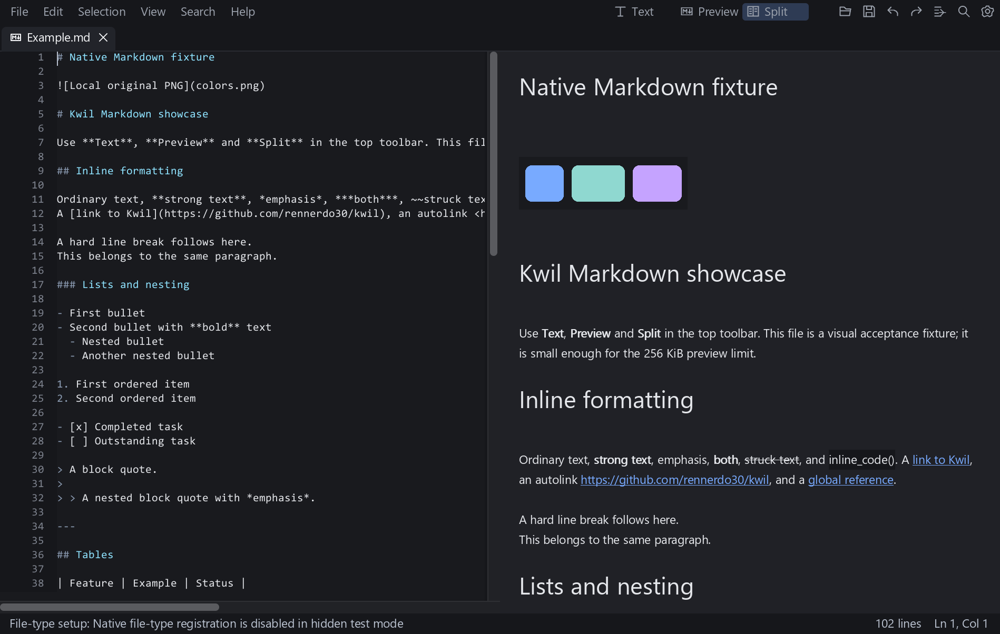
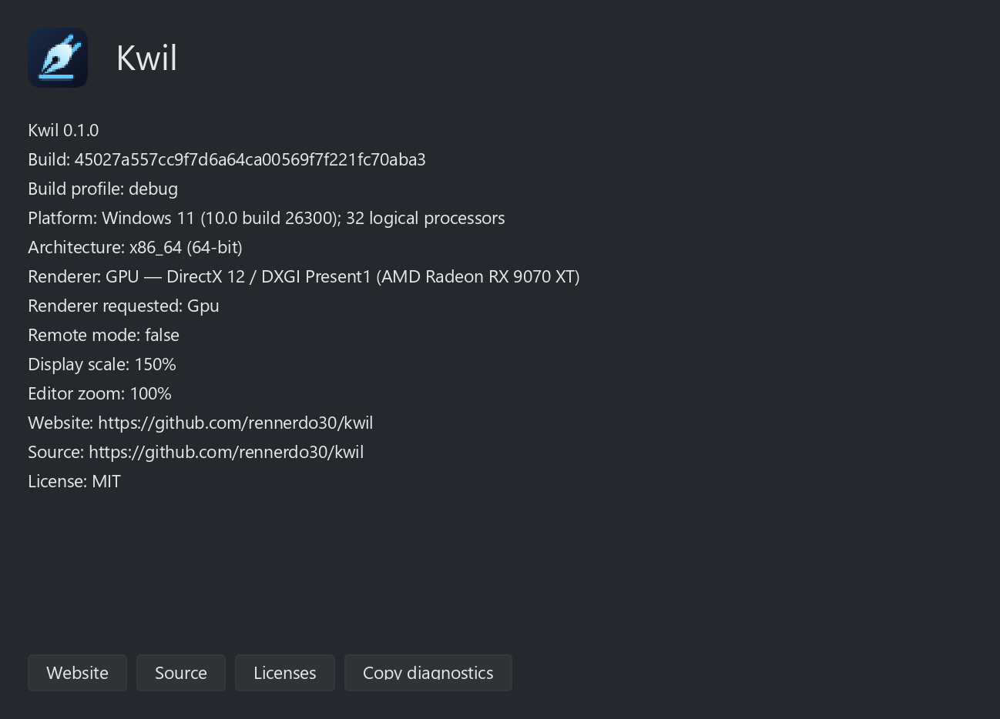
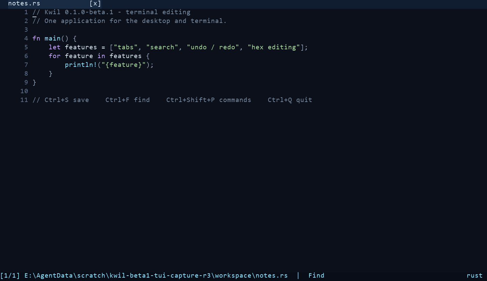
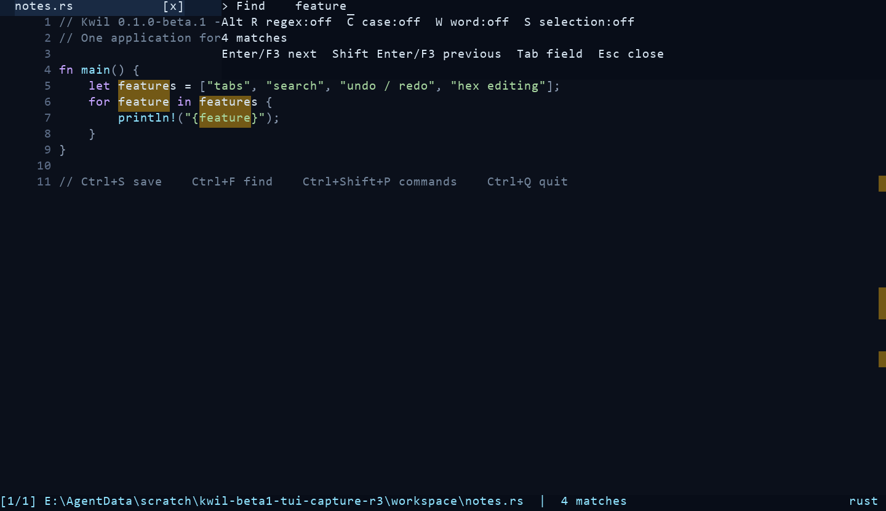

# Screenshots

The GUI images below are historical captures of Kwil's production GUI on Windows, taken on
24 October 2026 with a debug build and the `kwil-ui-gpu/frame-harness` feature.
They show sample content in the real application, rather than a mockup or spike
renderer. The two retained PNGs were copied unchanged into this repository.

The captured build predates documentation base
`37e128218cdc966e66caf40e8fdf26da761d9695`. Its receipt names base
`45027a557cc9f7d6a64ca00569f7f221fc70aba3` **plus uncommitted UI/measurement
changes**. Neither that base nor the About dialog's build field identifies the
complete dirty source tree. These images do not establish current-checkout,
release, performance, cross-platform or owner acceptance.

## Markdown split view

The small `Example.md` fixture shows source highlighting, rendered headings,
inline formatting and a local sample image. The selected **Split** control and
the **Text** and **Preview** controls belong to the captured development build.
Rendered Markdown preview has a 256 KiB logical-source limit in the
[v1 specification](SPEC.md#markdown); this frame does not demonstrate large-file
preview. The status message about disabled file-type registration comes from
hidden test mode, rather than a successful OS registration operation.

The frame is a DirectX 12 retained presentation texture readback, as stated by
`markdown-split.bmp.backend.txt`. It records application pixels; it does not
show the Windows desktop, compositor output or native caption buttons.

## Build diagnostics

The real About dialog records Kwil 0.1.0, Windows x86_64, a debug build,
DirectX 12 / DXGI Present1, 150% display scale and 100% editor zoom. Its build
field is the base commit above, with the dirty-source qualification preserved
here. `about-diagnostics.txt` agrees with the visible fields. The dialog capture
has its own `about.bmp.txt` receipt; no per-image backend sidecar is retained
for it, so the split frame's readback receipt is not attributed to this image.

## Retained evidence

Both images come from evidence set `desktop-final-toolbar-about` in the retained
`kwil-desktop-owner-fix-20261024` archive. The file names below identify the
original local receipts; they are not links to files shipped in this repository.
The source/build evidence remains with the maintainer. All hashes are SHA-256.

| Repository image | Original image | Bytes | SHA-256 of both copied and retained PNG |
| --- | --- | ---: | --- |
| `images/windows-markdown-split-20261024.png` | `images/markdown-split.png` | 195,144 | `BD26F11E2BD68075FC925036A0BDEF8BEF476AE5321C373D282CB79FBD59A435` |
| `images/windows-about-20261024.png` | `images/about.png` | 70,589 | `046055EB537BCB8F3603E1F655C36636C339BCC24F4B0B2F66C2EC1DA783660C` |

The retained PNGs and their BMP companions were visually inspected. No image was
recaptured, cropped, redacted, rescaled or re-encoded for this documentation.

| Original receipt/artifact | SHA-256 | What it records |
| --- | --- | --- |
| `lane.log` | `132BB0E54A279898A29E3BB3D6B456E223CB63C8231358E508E64D98A929C998` | Base plus dirty edits; build and native process exits 0 without timeout; executable hash. |
| `kwil.exe` | `B201C940D42F14F21991AB05B47AABD8011447E48F32BBBA39BEE8F05D21E38F` | Retained executable; hash independently matched to the lane receipt. |
| `source-before.csv` | `644C3FB9B87D19ED7423EBD897F4335A47A572E81513DF86AEDB632CAEBC701A` | Recorded gate: 46 GUI source files, not a complete workspace inventory. |
| `build.stderr.txt` | `7493CEEA2F1D7C61B422E03078E597EC57E0E9E2B4F84E03460FB71BA4BD55A4` | Historical successful debug build with production crates. |
| `images/markdown-split.bmp` | `98E46438F00F7DA24A0362CF3EE1595F6B3290D73CECE97758097CF227AFBF0D` | Retained BMP companion to the split-view PNG. |
| `images/markdown-split.bmp.txt` | `FA35BA39DD3B3E402A4067D7F3FCF804364137C7219E4001FC0CB6BC0EECADE6` | Named split capture, scale 1.5 and zoom 100. |
| `images/markdown-split.bmp.backend.txt` | `79F39BAFB58BDA4286ECCEE11CC86674A3C10BC55AB8868145F18CBCC1625301` | Explicit DX12 texture-readback method. |
| `images/about.bmp` | `E7F1B7DE57838E805C948E038C675CB70049758BF35F514BCB34F02E3AC7817A` | Retained BMP companion to the About PNG. |
| `images/about.bmp.txt` | `0822A82690C31174105792044B10992FAEDD30964D22A96640620723EB500D95` | Named About capture, scale 1.5 and zoom 100. |
| `images/about-diagnostics.txt` | `6107BA7957F3A48DF62CE5583F8E627717EB293ABA67AA2CAC5947F44937F23A` | Text diagnostics matching the dialog. |
| `images/native-window.txt` | `F75C9F5ED2523D958E5A5204D755C68F8A3DB1BD569FB057CA1B0BF0B1D9C208` | Historical native-window flags, including `cloaked=true`. |

The receipts describe that historical run only. This documentation change ran no
build, test or native application. Fresh captures and acceptance for later source
belong to a separately authorized validation run.

## Terminal beta captures

These are actual `0.1.0-beta.1` TUI sessions, captured on Windows on 26 October
2026 through an invisible ConPTY and rendered from the recorded VT output.
The executable is the downloaded release asset, not a test backend or a mockup.
The editor frame shows the supplied `notes.rs`; the search frame follows one
Ctrl+F and the query `feature`, with four matches reported by the real application.

- Tag: `v0.1.0-beta.1`, commit `904e5d586f18291ea5a0a0f2451d689b119e2f27`.
- Original asset: `kwil-x86_64-pc-windows-msvc.com`, renamed `kwil.com` next to
  its matching `kwil.exe` in a private portable directory.
- Executable SHA-256: `ED02E6BE017860FD71B9B5898F1E702147C47F4190100D039A5118A343E63143`.
- Terminal: 120 columns × 32 rows, rendered at 1440 × 832 pixels.
- Font: the installed Windows Consolas, 20 pixels, on a 12 × 26 pixel cell grid;
  no font file is redistributed. The underline cursor shape is a renderer choice;
  its position and visibility come from the stream.
- Replay preserves recorded cursor movement, cell colours, erasure and search
  highlights. Default terminal colours are supplied by the renderer: foreground
  RGB `214,228,240`, background RGB `11,16,27`. Application RGB colours come from
  the stream. No UI cells were added, removed or retouched.
- The process had its own workspace, profile and fixture. No desktop window,
  focus change or global keyboard injection was used.

| Image | PNG SHA-256 | Source VT SHA-256 |
| --- | --- | --- |
| `tui-editor-beta1-20261026.png` | `5FD3F7AC9B181BF9B0130E456DA8EF3CE0EDA1CB908E8F3558719A5C212A7F24` | `4A2C4422F5F28D5AED0AEFD6C8EBF9B7CC29D46EDEAB55DF3B93EA6F7CE614A8` |
| `tui-search-beta1-20261026.png` | `C7A0B6575FC3A8AD15B5EE9F4350F57487370B7D436414C280B14B572A3A500F` | `A8F2F2B7A94D9DE1B46964CBA6B308BBE0F85237D4958AEA390969923165F962` |

The maintainer retains the complete stream, capture/replay scripts, text-cell
exports and process receipts as `kwil-beta1-tui-capture-r3`. Both final PNGs were
visually inspected. This is a rendering of recorded terminal cells, not a
photograph or desktop-terminal screenshot; it does not establish another
terminal emulator's font metrics, accessibility, performance or platform parity.

**The session did not pass normal-exit qualification.** After these captures,
quit retained `WrapThreadExitPending`; the controller terminated and reaped its
exact owned process (PID 28656). That failure is preserved separately from the
images and is not presented as a successful packaged smoke test.