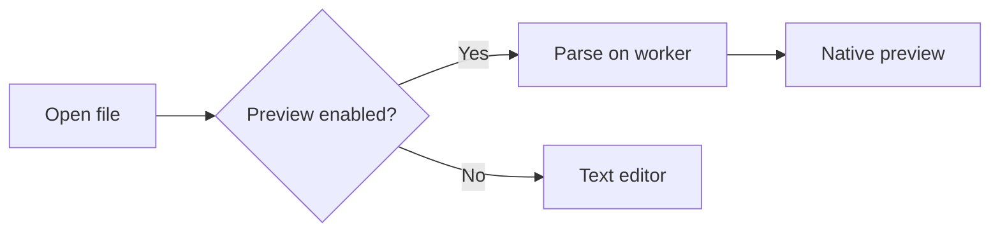
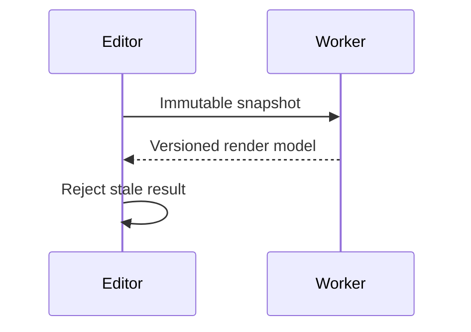

# Kwil Markdown showcase

Use **Text**, **Preview** and **Split** in the top toolbar. This file is a visual acceptance fixture; it is small enough for the 256 KiB preview limit.

## Inline formatting

Ordinary text, **strong text**, *emphasis*, ***both***, ~~struck text~~, and `inline_code()`.
A [link to Kwil](https://github.com/rennerdo30/kwil), an autolink <https://github.com/rennerdo30/kwil>, and a [global reference][kwil].

A hard line break follows here.  
This belongs to the same paragraph.

### Lists and nesting

- First bullet
- Second bullet with **bold** text
  - Nested bullet
  - Another nested bullet

1. First ordered item
2. Second ordered item

- [x] Completed task
- [ ] Outstanding task

> A block quote.
>
> > A nested block quote with *emphasis*.

---

## Tables

| Feature | Example | Status |
| :--- | :---: | ---: |
| Inline styles | **Strong**, *emphasis*, `code` | Ready |
| Links | [Kwil][kwil] | Reference |
| Escapes | A \| B | Literal pipe |

## Local images

The original fixture below loads from this directory on the preview worker. No network image is requested.


## Fenced code

```rust
fn main() {
    let message = "Hello, Kwil";
    println!("{message}");
}
```

```json
{"level":"INFO","timestamp":"2026-10-24T12:00:00Z","message":"JSON inside a log"}
```

```python
for item in range(3):
    print(f"item={item}")
```

## Mermaid acceptance cases

These examples exercise the bounded native flowchart and sequence renderer. Unsupported Mermaid declarations must show a clear explanation and preserve their original fenced source.





## Safety and long content

Raw HTML is never executed: <script>this must not run</script>.

A very long word must wrap without losing characters:

abcdefghijklmnopqrstuvwxyzABCDEFGHIJKLMNOPQRSTUVWXYZ0123456789abcdefghijklmnopqrstuvwxyzABCDEFGHIJKLMNOPQRSTUVWXYZ0123456789abcdefghijklmnopqrstuvwxyzABCDEFGHIJKLMNOPQRSTUVWXYZ0123456789

Unicode: 日本語, café, naïve, emoji 🙂, and combining é.

[kwil]: https://github.com/rennerdo30/kwil "Kwil source"
